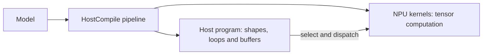
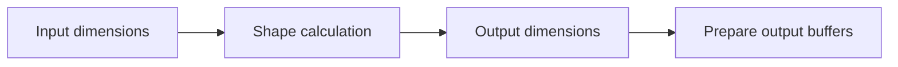
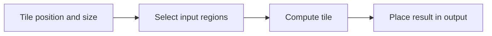
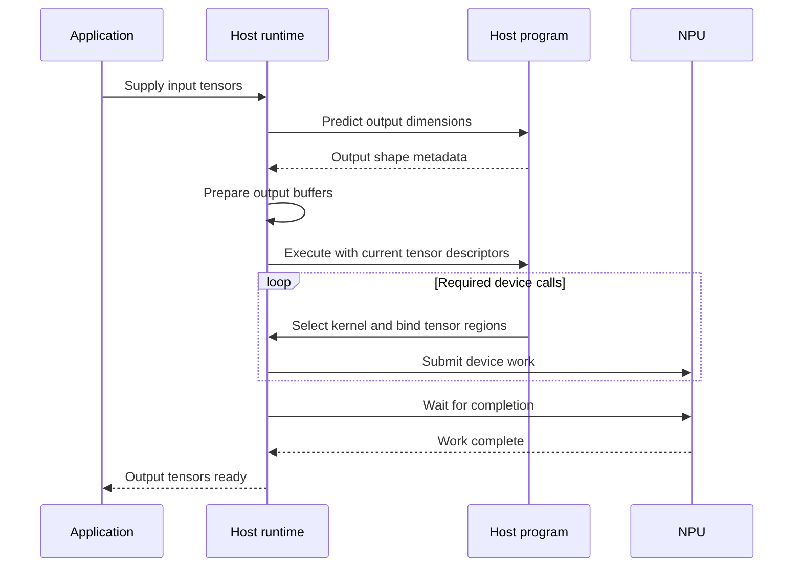

# HostCompile design

HostCompile compiles a model into a host program and a set of NPU kernels. The host program handles
shapes, loops, buffers and the order of execution. The kernels perform the tensor computation on
the NPU. Here, a *kernel* means an independently compiled piece of the model; it can contain
several operations.

This separation lets the host react to the input shape while reusing compiled device work. It is
useful for dynamic models and for expressing repeated calls to device functions. This guide uses
bounded dynamic shapes to explain the design and describes the responsibilities of the host and device
paths.

## Table of contents

- [Overview](#overview)
- [Shapes and bounds](#shapes-and-bounds)
- [Tiling](#tiling)
- [Device kernels](#device-kernels)
- [Host execution](#host-execution)

## Overview

### The two parts of the program



The compiler prepares both parts. During inference, the host program selects and dispatches the
device work using the current tensors. Shape changes within the supported range are handled by
this program; they do not require compiling a new device kernel for every input size.

The chapters follow how the compiler builds this program. They describe responsibilities and
the information passed between them, rather than a complete list of compiler passes.

### Where the host and device paths separate

The compilation diagram gives a more detailed view of the dialect levels. The device
path lowers tensor computation into buffers, tasks and NPU binaries. The host path keeps the
shape calculations and control flow needed to manage those binaries.


The CPU side represents host execution. Depending on the selected backend, it runs interpreter
bytecode or JIT-compiled host code, as described in [Host execution](#host-execution).

### The running example

We use elementwise addition with two inputs of the same shape:

```text
Y[i] = A[i] + B[i]
```

Assume one dimension, called width, can change between inferences and has an upper bound of 1000.
For one inference its value is 250. A tile width of 100 will illustrate the difference between
the whole tensor, the work described by a loop, and a device kernel's shape.

These numbers illustrate the mechanism. Real tile choices also depend on the target, layout,
memory capacity and operation constraints. The examples omit those details and broadcasting.

The MLIR examples show selected intermediate stages. Bounds, layout and target attributes are
omitted to keep the control flow visible. The tiling examples use one-dimensional tensors and
declare the Add function without its device body; they illustrate the calling structure rather
than defining a complete NPU model.

For configuration examples, see
[How to use HostCompile mode](../guides/project_structure.md#how-to-use-hostcompile-mode).

## Shapes and bounds

A dynamic dimension is a size that is not fixed when the model is compiled. A bound tells the
compiler how large that dimension may become. Inference supplies its actual size.

### Keep four quantities separate

| Quantity | Example | Purpose |
| --- | --- | --- |
| Model shape | `[1, 16, 8, W]` | Describes the logical dimensions of a tensor. |
| Upper bound | `W <= 1000` | Lets the compiler plan for the largest allowed width. |
| Actual shape | `[1, 16, 8, 250]` | Describes the values present in this inference. |
| Device tile shape | `[1, 16, 8, 100]` | Describes one piece of compiled device work. |

The upper bound is not the number of valid elements. Allocating enough storage for width 1000
does not make a width-250 tensor contain 1000 valid values. A dimension marked `?` in tensor IR
is still dynamic even when it carries a known upper bound.

The compiler needs both shape inference and bounds inference as operations transform the model.
For equal-shape Add, the output has the same shape as its inputs. Other operations may change
rank, reorder dimensions or derive a new size. Those rules must preserve valid bounds as well.

### Predicting output shapes

Before computing tensor values, the runtime needs to know the output dimensions so that it can
prepare output buffers. HostCompile extracts the required shape calculations into a separate
host function.



For our Add example, the calculation simply copies the input dimensions to the output shape.
The following is pseudocode; it does not add any tensor values:

```text
predict_output_shape(input_shape):
    return input_shape
```

At the tensor IR level, reading a dimension is expressed with `tensor.dim`. This simplified
shape function combines the current width with the fixed dimensions in logical `[N, C, H, W]`
order:

```mlir
func.func @output_shape(%input: tensor<1x16x8x?xf16>) -> tensor<4xindex> {
  %c1 = arith.constant 1 : index
  %c16 = arith.constant 16 : index
  %c8 = arith.constant 8 : index
  %width_axis = arith.constant 3 : index
  %width = tensor.dim %input, %width_axis : tensor<1x16x8x?xf16>
  %shape = tensor.from_elements %c1, %c16, %c8, %width : tensor<4xindex>
  return %shape : tensor<4xindex>
}
```

For width 250, it returns `[1, 16, 8, 250]`. Later lowering changes how the shape is passed to
the runtime; this example shows the calculation before that change.

The compiler replaces shape queries on operation results with the arithmetic needed to calculate
them. This is called *shape reification*. The extracted function must contain supported host
calculations. Merely knowing an output's upper bound is not enough to predict its actual size.

Static output dimensions become constants in this function. A fixed output shape therefore says
nothing by itself about whether the work producing that output depends on dynamic input sizes.
If output sizes depend on tensor contents, the layer needs an explicit supported way to obtain
them; copying input dimensions is insufficient.

### Destination-passing style

In MLIR, destination-passing style (DPS) means that a tensor result is expressed together with a
matching destination operand that provides the initial storage to update. This makes the buffer
that will hold the result explicit in the IR instead of leaving it to be synthesized later.

MLIR uses DPS as part of bufferization: ops that follow this pattern implement
[DestinationStyleOpInterface](https://github.com/llvm/llvm-project/blob/main/mlir/include/mlir/Interfaces/DestinationStyleOpInterface.td),
and [One-Shot Bufferize](https://mlir.llvm.org/docs/Bufferization/#destination-passing-style)
can reuse the destination buffer when aliasing is safe.

In HostCompile, this matters because the compiler can prepare result storage up front and keep that
storage available through outlining and later bufferization instead of introducing another
allocation and copy.

There are two closely related ways this shows up in the pipeline. The `scf.for` loop form is the
classic DPS-like case, where the loop carries the destination buffer as an `iter_arg` and each
iteration writes its result into a view of that buffer.

The dynamic-kernel case is also DPS-like rather than a real destination-passing contract: the compiler
prepares an exact destination at the call boundary so later bufferization can reuse it, but the op
contract itself stays unchanged. See [HostCompile with Dynamic Kernels](host_compile_with_dynamic_kernels.md)
and [HostCompile pipeline with dynamic kernels](prepare_dynamic_kernel_allocation_sizes.md) for that
boundary-level preparation.

At this point the compiler has a way to describe the result's dimensions. The next chapter
explains how it divides the computation that produces the result's values.

## Tiling

Tiling divides an operation into smaller pieces of work. A tile must fit the device's memory and
execution constraints. In HostCompile, a loop can describe repeated tile work while leaving the
number of iterations dependent on the actual tensor size.

### What the host loop describes

For equal-shape Add, each output tile needs the matching region of both inputs. With width 250
and a planned step of 100, the initial loop describes these slices:

| Iteration | Start | Width | Output indices |
| --- | --- | --- | --- |
| 0 | 0 | 100 | 0 through 99 |
| 1 | 100 | 100 | 100 through 199 |
| 2 | 200 | 50 | 200 through 249 |

This runnable Python example shows the tensor calculation represented by that loop. It is a
teaching example:

```python
a = list(range(250))
b = [10] * 250
y = [None] * len(a)
step = 100

for start in range(0, len(a), step):
    size = min(step, len(a) - start)
    a_tile = a[start:start + size]
    b_tile = b[start:start + size]
    y[start:start + size] = [x + z for x, z in zip(a_tile, b_tile)]

assert y == [x + z for x, z in zip(a, b)]
```

In the compiler's intermediate representation (IR), `scf` means *structured control flow*.
An `scf.for` represents the loop. Tensor slices represent the inputs to a tile and the position
of its result in the output.



The current slice size can be a runtime value, as on the final iteration above. This is an intermediate
description of the work. The next chapter explains how the compiler turns it into calls with
fixed device shapes.

### The loop in MLIR

The example below uses two input tensors, `%a` and `%b`, each containing 250 values. The loop
starts a tile at offsets 0, 100 and 200, adds the corresponding input slices, and assembles the
output tensor.

```mlir
#tile_size = affine_map<(offset)[width] -> (width - offset, 100)>

func.func private @elementwise_add(tensor<?xf16>, tensor<?xf16>) -> tensor<?xf16>

func.func @host(%a: tensor<?xf16>, %b: tensor<?xf16>) -> tensor<?xf16> {
  %c0 = arith.constant 0 : index
  %c100 = arith.constant 100 : index
  %width = tensor.dim %a, %c0 : tensor<?xf16>
  %initial_output = tensor.empty(%width) : tensor<?xf16>
  %result = scf.for %offset = %c0 to %width step %c100
      iter_args(%output_so_far = %initial_output) -> (tensor<?xf16>) {
    %size = affine.min #tile_size(%offset)[%width]
    %a_tile = tensor.extract_slice %a[%offset] [%size] [1]
        : tensor<?xf16> to tensor<?xf16>
    %b_tile = tensor.extract_slice %b[%offset] [%size] [1]
        : tensor<?xf16> to tensor<?xf16>
    %tile_result = func.call @elementwise_add(%a_tile, %b_tile)
        : (tensor<?xf16>, tensor<?xf16>) -> tensor<?xf16>
    %updated_output = tensor.insert_slice %tile_result
        into %output_so_far[%offset] [%size] [1]
        : tensor<?xf16> into tensor<?xf16>
    scf.yield %updated_output : tensor<?xf16>
  }
  return %result : tensor<?xf16>
}
```

Read the main pieces as follows:

- **`tensor.dim %a, %c0` reads a dimension's size.** `%a` is the input tensor, and `%c0` is
  the integer constant 0. Here, 0 selects the tensor's only axis. Because `%a` contains 250
  elements, the result `%width` is 250. This reads shape information, not the value at `%a[0]`.
- **`%offset` is the starting element index.** The loop starts at 0 and advances by 100 while
  the offset is less than 250, so its values are 0, 100 and 200. These are positions in the
  tensor; the iteration numbers are 0, 1 and 2.
- **`#tile_size` describes two candidate sizes.** `(offset)` and `[width]` name its inputs:
  the changing tile position and the width that stays fixed during this loop. The expression
  `(width - offset, 100)` produces the remaining element count and the planned tile size.
  `affine.min` evaluates both and returns their minimum as the single value `%size`:

  | `%offset` | Candidate sizes | `%size` |
  | --- | --- | --- |
  | 0 | `(250, 100)` | 100 |
  | 100 | `(150, 100)` | 100 |
  | 200 | `(50, 100)` | 50 |

- **`iter_args` passes values from one iteration to the next.** Here it passes the full output
  tensor. The first iteration receives `%initial_output` as `%output_so_far`. Each iteration
  uses `scf.yield` to pass `%updated_output` to the next iteration as its `%output_so_far`.
  After the loop, `%result` is the last tensor yielded. The loop advances `%offset` separately;
  it does not need an entry in `iter_args`. `tensor.empty` provides the initial tensor's shape,
  with unspecified element values that the iterations fill.
- **`tensor.extract_slice %a[%offset] [%size] [1]` selects an input region.** The three lists
  mean starting offsets, sizes and strides, with one entry per dimension. For this 1D tensor,
  offset 200, size 50 and stride 1 select elements 200 through 249, like Python's `a[200:250]`.
- **`@elementwise_add` computes the values for one tile.** It adds corresponding elements of
  `%a_tile` and `%b_tile`. The `@` identifies a function name; `%tile_result` names its result.
  Placing that result in the full output is the separate `tensor.insert_slice` operation.
- **`%updated_output` is the full output tensor after inserting this tile.** `tensor.insert_slice`
  preserves the other positions and returns a new tensor value. After the first iteration,
  positions 0 through 99 have their answers; later iterations fill 100 through 199 and 200
  through 249. This describes tensor values; bufferization later decides how storage is used.

At width 250, the last call has a slice of width 50. Its dynamic tensor type reflects this
stage of compilation.

### Each layer defines its input regions

Add without broadcasting uses identical regions from its two inputs. With broadcasting, an
input dimension of size one stays at size one while the matching output dimension is tiled.
For example, adding a single bias value to 250 values must reuse that bias for every tile.

A convolution needs neighboring input values around an output tile. This extra input region is
often called a *halo*. Its size and position depend on the kernel, stride and padding. A layer's
tiling support must describe those relationships; copying Add's slicing rule would be incorrect.

The output also needs a valid assembly rule. The Add example places independently computed
values at their output positions. An operation whose outputs depend on a wider input region
needs a tiling rule that preserves that dependency.

## Device kernels

The compiler separates device computation from host control by moving compute regions into
functions. This step is called *outlining*. Host loops retain the calls, shape calculations and
slice positions. Each outlined region can contain a group of operations.

In the SCF path described here, the compiler then turns dynamically shaped device calls into
calls whose device tensor shapes are concrete. The host still chooses where the data comes from
and which function to call at runtime.

Some kernels cannot be reduced to a simple static host loop and must remain dynamic on the device.
Those cases are described in [HostCompile with Dynamic Kernels](host_compile_with_dynamic_kernels.md).

### Making the last tile fit

The initial Add loop has tile widths 100, 100 and 50. A device kernel compiled for width 100
cannot simply be given a 50-element region and treated as a width-50 kernel.

For this pointwise operation, the compiler can move the final window backward so that it has
the full width of 100:

| Loop position | Adjusted start | Device width | Output indices |
| --- | --- | --- | --- |
| 0 | 0 | 100 | 0 through 99 |
| 100 | 100 | 100 | 100 through 199 |
| 200 | 150 | 100 | 150 through 249 |

The final two windows overlap. Values 150 through 199 are computed twice, but both computations
produce the same Add result. The input windows and output placement must all move together.

This runnable example shows the adjusted calculation:

```python
a = list(range(250))
b = [10] * 250
y = [None] * len(a)
step = 100
assert len(a) >= step

for position in range(0, len(a), step):
    start = min(position, len(a) - step)
    for i in range(start, start + step):
        y[i] = a[i] + b[i]

assert y == [x + z for x, z in zip(a, b)]
```

The adjustment requires the actual width to be at least the fixed tile width. Smaller widths
need another supported plan. An upper bound alone does not establish that this plan works for
every smaller shape. Overlapping writes also need correct scheduling; identical values do not
make concurrent writes automatically safe.

### A fixed-shape call in MLIR

After tile adjustment and conversion to static device shapes, the Add function accepts and
returns `tensor<100xf16>`. Once device functions are packaged into nested modules, the host uses
`Core.NestedCall` to name both the module and the function. The following map and declaration
belong at module level:

```mlir
#tile_start = affine_map<(offset)[width] -> (width - 100, offset)>

module @device {
  func.func nested @elementwise_add_100(
      tensor<100xf16>, tensor<100xf16>) -> tensor<100xf16>
}
```

This fragment replaces the body of the previous host loop. The compiler also adds a check that
the actual width is at least 100. `%start` is the smaller of the loop position and `width - 100`:

```mlir
%start = affine.min #tile_start(%offset)[%width]
%a_tile = tensor.extract_slice %a[%start] [100] [1]
    : tensor<?xf16> to tensor<100xf16>
%b_tile = tensor.extract_slice %b[%start] [100] [1]
    : tensor<?xf16> to tensor<100xf16>
%tile_result = Core.NestedCall @device::@elementwise_add_100(%a_tile, %b_tile)
    : (tensor<100xf16>, tensor<100xf16>) -> tensor<100xf16>
%updated_output = tensor.insert_slice %tile_result
    into %output_so_far[%start] [100] [1]
    : tensor<100xf16> into tensor<?xf16>
scf.yield %updated_output : tensor<?xf16>
```

At width 250, `%start` becomes 0, 100 and 150. Both input slices and output placement use that
same offset. The host tensors remain dynamic, while the device call has a fixed tile shape.
The real signature also carries stride information so that the fixed shape can refer to the
appropriate region of the current input buffers.

### What must be fixed at the call

The compiler must establish a supported concrete device shape for every affected call argument
and result. A runtime dimension with no supported mapping prevents this conversion. Adding a
loop or accepting a dynamic tensor earlier in the pipeline does not establish that mapping.

A tensor cast does not solve the problem: it changes the type view without copying, padding or
creating valid data. The device's fixed compute dimensions also do not imply that the input
buffer's address, offset or strides are fixed. Those are the subject of the next chapter.

## Host execution

After separating host control from device computation, the compiler prepares both for execution.
The device functions are compiled into NPU ELF binaries. The host program carries the shape
calculations, loops, buffer handling and calls that use those binaries.

### Host backends

| Mode | Host representation | How it runs |
| --- | --- | --- |
| `HostCompile_Interpreter` | Bytecode packaged with device binaries and metadata. | A host virtual machine interprets the bytecode and dispatches NPU work. |
| `HostCompile_JIT` | MLIR in the LLVM dialect, with device binaries embedded. | The host runtime JIT-compiles the host representation for CPU execution. |

Both execute host control around compiled NPU kernels. JIT means *just-in-time*: the host runtime
converts the exported representation into CPU machine code when preparing it for execution.
For the standard mode and configuration examples, see
[How to use HostCompile mode](../guides/project_structure.md#how-to-use-hostcompile-mode).
For the interpreter's binary representation, see the [bytecode format](bytecode_format.md).

### One inference



This is the logical sequence for an inference that needs host execution. The runtime can prepare
or record commands before submitting them, and dependencies can require additional waits between
device calls. Output values are ready only after the required work completes.
