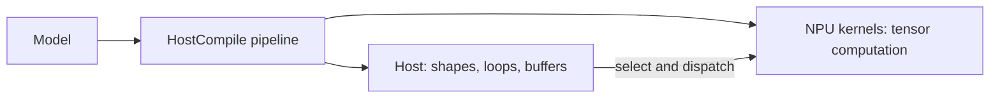
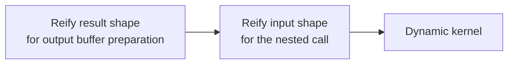

# HostCompile with Dynamic Kernels

*Epic*: E-196823 Support Host and NPU dynamism in a single pipeline

This document extends [HostCompile design](host_compile.md) and focuses on the cases that do not fit the regular `scf.for`-based flow. The baseline design explains the common pieces: host orchestration, shape handling, tiled device calls, and the split between host and NPU execution. This note keeps that structure and describes only the dynamic-kernel-specific parts.

The target is to support two compilation styles in one pipeline:

- HostCompile for host-side orchestration, partitioning and kernel dispatch;
- NPU dynamism for kernels whose execution boundaries or shape handling cannot be reduced to static host-side loop blocks; they must remain dynamic and execute on the device.

The current practical use case for this path is IE operations implementing `LayerWithDmaInterface`, such as `Interpolate` and `Atan`, which lower to DMA-backed VPU operations such as `VPU.InterpolateDMA` and `VPU.AtanDma`. These operations require explicit shape handling while still participating in HostCompile partitioning and nested kernel dispatch.

## Overview

### The two parts of the program



The baseline HostCompile flow already separates host control from device work. The difference here is that some kernels cannot be flattened into a regular `scf.for` shape loop without losing the runtime shape behavior that their execution depends on. In those cases, the compiler must keep both the host orchestration and the dynamic kernel semantics alive.

### Where this doc differs from the base design

The general concepts of shapes, bounds, tiling and host execution are described in [HostCompile design](host_compile.md). The material below only covers what is new for dynamic kernels:

- the compiler must preserve dynamic function signatures;
- function's input shape preparation and propagation must happen before `Core.NestedCall` (the host call to the outlined nested kernel function) so the host can pass explicit shape buffers;
- DPS-style destination buffers preparation at the dynamic function boundary

The exact destination preparation mechanism is described separately in [HostCompile pipeline with dynamic kernels. Mimic destination-passing style at the function boundary](prepare_dynamic_kernel_allocation_sizes.md). For the general meaning of destination-passing style in MLIR, see [Destination-passing style](host_compile.md#destination-passing-style). This note keeps the boundary-level idea and the host-call integration points, while the dedicated design explains how the exact-sized destination is prepared before outlining.

### The running example

We use a kernel whose shape is not fully static at compile time, but whose host orchestration still follows the HostCompile model. The compiler lowers the model into a host function and one or more kernel functions. The host function carries the dynamic extents, materializes shape buffers, and dispatches the kernels through nested calls.

For configuration examples, see [How to use HostCompile mode](../guides/project_structure.md#how-to-use-hostcompile-mode).

## Shapes and bounds

Dynamic-kernel support still follows the same basic distinction between a model shape, an upper bound and the runtime value. The difference is that the compiler can no longer assume the shape becomes a simple loop-trip-count problem, so it needs additional shape preparation and propagation.

## Dynamic kernels

### Accepting dynamic host functions

The compiler must accept nested functions whose IR types stay dynamic. The following is representative:

```mlir
net.NetworkInfo entryPoint : @main_func1 inputsInfo : {
	DataInfo "in_0" tensorNames = ["in_0"] : tensor<1x?x?x16xf16, {bounds = #const.OpaqueI64Elements<[1, 256, 512, 16]> : tensor<4xsi64>, order = #NCHW}>
	DataInfo "in_1" tensorNames = ["in_1"] : tensor<2xf32>
	DataInfo "in_2" tensorNames = ["in_2"] : tensor<1x1x1x1323060xui8>
} outputsInfo : {
	DataInfo "out_0" tensorNames = ["out_0"] : tensor<1x?x?x16xf16, {bounds = #const.OpaqueI64Elements<[1, 2048, 4096, 16]> : tensor<4xsi64>, order = #NCHW}>
}

func.func nested @main_func1(%main: memref<1x?x?x16xf16, strided<[?, ?, ?, ?], offset: ?>>,
									 %main_0: memref<2xf32, strided<[?], offset: ?>>,
									 %main_1: memref<1x1x1x1323060xui8, strided<[?, ?, ?, ?], offset: ?>>,
									 %main_3: memref<1x?x?x16xf16, strided<[?, ?, ?, ?], offset: ?>>)
		-> (memref<1x?x?x16xf16, strided<[?, ?, ?, ?], offset: ?>>) {
	...
}
```

Compiler changes required to support NPU functions with dynamic signatures are out of scope for this document. It stays at the design-overview level and focuses on the behavior, boundaries, and responsibilities of the dynamic-kernel flow.

The important part is that the arguments are dynamic, but the host still needs concrete allocation sizes. Those sizes are prepared before outlining so the nested call can reuse the destination buffer instead of allocating from an upper bound. The dedicated preparation flow is described in [prepare_dynamic_kernel_allocation_sizes.md](prepare_dynamic_kernel_allocation_sizes.md).

### Dynamic function results buffer allocation

Before outlining a dynamic compute function, the `PrepareDynamicKernelAllocationSizes` pass reifies the result shapes for eligible VPU operations outside `scf.for` regions and inserts an exact-sized `tensor.empty` followed by `tensor.insert_slice`.

This prepares the result buffer in a DPS-like form so downstream bufferization can reuse that destination instead of materializing another upper-bounded allocation and copy.

The detailed preparation flow is described in [prepare_dynamic_kernel_allocation_sizes.md](prepare_dynamic_kernel_allocation_sizes.md).

### Function's input shape preparation and propagation before the nested call

The host must materialize the current runtime extents, meaning the runtime sizes of the dynamic dimensions, before `Core.NestedCall` so it can fill the shape buffers. This is implemented in the `PropagateDynamicShapes` pass, which reads those runtime dimensions values and writes them into the explicit input shape buffers at the call site.

The example below shows the two sides of that flow: the nested function receives explicit shape buffers, and the host fills those buffers before the call.

The first block shows the outlined nested function signature with explicit shape-buffer memref operands.

```mlir
module @DirectDynamicInput {
  module @Module0 {
    func.func nested @main_func0(%inputTensor: memref<1x16x4x?xf16>, %inputShapeBuffer: memref<4xsi32>,
                                 %outputTensor: memref<1x16x4x?xf16>, %outputShapeBuffer: memref<4xsi32>)
                                 -> (memref<1x16x4x?xf16>, memref<4xsi32>) {
      return %outputTensor, %outputShapeBuffer : memref<1x16x4x?xf16>, memref<4xsi32>
    }
  }
```

The second block shows how the host materializes the runtime extent, fills the shape buffers, and then calls the outlined function.
```mlir
  func.func @main(%sourceTensor: memref<1x16x4x?xf16>, %resultTensor: memref<1x16x4x?xf16>) -> memref<1x16x4x?xf16> {
    ...

    // Prepare the runtime extent for the dynamic dimension
    %runtimeExtent = memref.dim %sourceTensor, %c3 : memref<1x16x4x?xf16>
    %outputTensorBuffer = memref.alloc(%runtimeExtent) : memref<1x16x4x?xf16>

    // Allocate the explicit input shape buffer
    %inputShapeBuffer = memref.alloc() : memref<4xsi32>

    // Allocate the explicit output shape buffer
    %outputShapeBuffer = memref.alloc() : memref<4xsi32>

    // Store the runtime dimension into the shape buffer
    %runtimeExtentI32 = arith.index_cast %runtimeExtent : index to i32
    %runtimeExtentSi32 = builtin.unrealized_conversion_cast %runtimeExtentI32 : i32 to si32
    memref.store %runtimeExtentSi32, %inputShapeBuffer[%c0] : memref<4xsi32>

    // Store the static dimensions alongside the dynamic one
    %staticExtent4 = builtin.unrealized_conversion_cast %c4_i32 : i32 to si32
    memref.store %staticExtent4, %inputShapeBuffer[%c1] : memref<4xsi32>
    ...

    // Call the outlined nested function with the prepared shape buffers and exact-sized destination
    %callResult:2 = Core.NestedCall @Module0::@main_func0(%sourceTensor, %inputShapeBuffer, %outputTensorBuffer, %outputShapeBuffer)
        : (memref<1x16x4x?xf16>, memref<4xsi32>, memref<1x16x4x?xf16>, memref<4xsi32>)
        -> (memref<1x16x4x?xf16>, memref<4xsi32>)

    memref.copy %callResult#0, %resultTensor : memref<1x16x4x?xf16> to memref<1x16x4x?xf16>
    return %resultTensor : memref<1x16x4x?xf16>
  }
}
```

The pass reads the dynamic source shape from the input operand, converts each extent to the shape-buffer element type and writes the values in reverse dimension order. Static dimensions become constants; dynamic dimensions are extracted with `memref.dim`. The explicit `si32` cast matters because the shape buffer is modeled as `memref<4xsi32>`, so the host must store the runtime extent in the exact signed 32-bit element type expected by the nested call.

The `arith.index_cast` and `builtin.unrealized_conversion_cast` ops are shown in the example to make that type conversion explicit in MLIR. The filled shape is then passed to `sw.kernel` so it can infer the correct shape.

### Flow diagram

For the base HostCompile flow, see [HostCompile design](host_compile.md).



The difference from the base HostCompile flow is that some kernel boundaries and shape chains remain dynamic. The host must therefore preserve the extra shape materialization steps described above while still following the same execution choreography.
