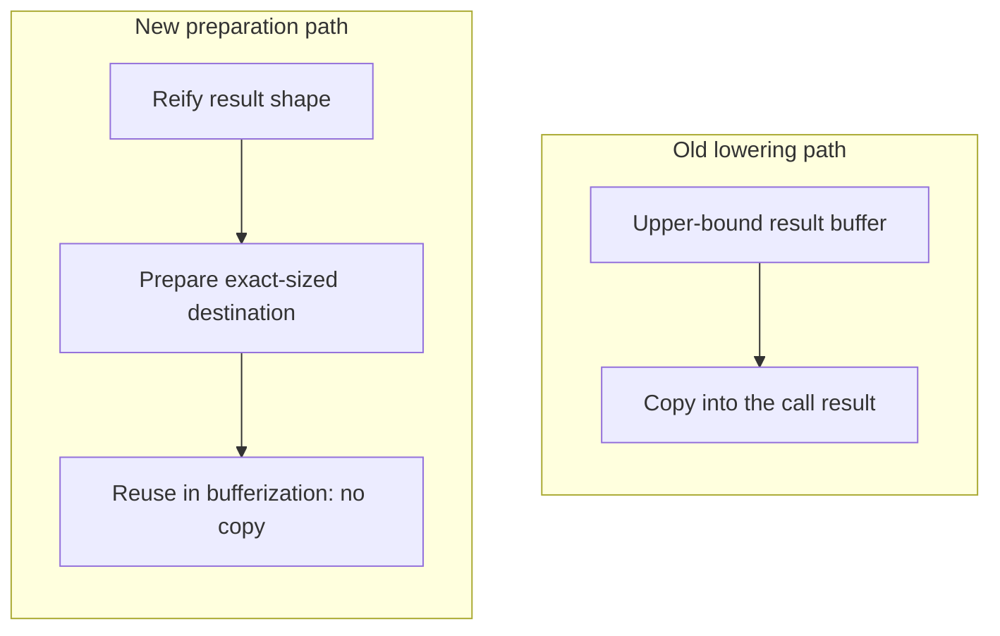

# HostCompile pipeline with dynamic kernels. Mimic destination-passing style at the function boundary

This document covers the result-buffer preparation step used by HostCompile when dynamic kernels remain outlined as dynamic compute functions. It complements [HostCompile design](host_compile.md) and [HostCompile with Dynamic Kernels](host_compile_with_dynamic_kernels.md).

## Problem

This work was motivated by an accuracy issue in a dynamic subgraph: the DMA-backed `VPU.InterpolateDMA` lowering was getting upper-bound output strides instead of runtime-correct strides, which could produce wrong results. The root cause was that dynamic compute functions produced by host compilation could end up with result buffers allocated from the upper bounds instead of the actual runtime sizes.

The practical failure mode was an upper-bounded `memref.alloc` followed by a `Core.NestedCall` that wrote into that buffer and then relied on later copy or cast chains. The allocation did not match the exact runtime extents needed by the DMA path, so the resulting strides were wrong.

The goal is to avoid that extra upper-bounded allocation when the exact runtime size is already known or can be reified before outlining, so the call boundary can carry the correct destination buffer and strides.

## Goal

Prepare an exact-sized destination before dynamic kernels are outlined, so later lowering can reuse that destination directly instead of materializing another upper-bounded allocation and copy.

## Design

The proposed `PrepareDynamicKernelAllocationSizes` pass would run before outlining dynamic compute functions. For eligible VPU ops outside `scf.for` regions, it would reify the result shapes and insert an exact-sized `tensor.empty` followed by `tensor.insert_slice`.



```mlir
%shape = reify_result_shape
%dst = tensor.empty(%shape) : tensor<...>

%op = ..
%result = tensor.insert_slice %op into %dst : tensor<...>
```

This mimics destination-passing style at the boundary:

- the exact destination is created up front,
- the dynamic result is inserted into that destination,
- downstream bufferization can reuse that prepared buffer,
- the later host-call lowering no longer has to invent an extra upper-bounded allocation for the same result.

We mimic DPS instead of making it the real op contract because we want the reuse benefits of DPS without changing operation interfaces or taking on the long-term maintenance cost of a contract change.

In practice, the pass is paired with the call-boundary bufferization logic in `allocate_buffers_for_net_results.cpp`, which can recognize a reusable destination when it is already established before the call.

## Examples

### Old allocation pattern

The old lowering path allocates from the upper bound and threads that buffer into the nested call. The example below shows the extra upper-bounded destination that this pass is meant to avoid:

```mlir
%result = memref.alloc(%upperBoundH, %upperBoundW) : memref<1x3x?x?xf16>
%resultView = memref.cast %result : memref<1x3x?x?xf16> to memref<1x3x?x?xf16, strided<[?, ?, ?, ?], offset: ?>>
%call:2 = Core.NestedCall @ModuleDyn::@main_func0(%input, %scales, %shape, %resultView, %shapeOut)
```

### Exact-Size Destination Preparation

The improved path computes the runtime dimensions first, allocates the exact destination, and then reuses that destination at the call boundary. The example below shows the exact-sized buffer that later lowering can reuse directly:

```mlir
%shape = reify_result_shape
%result = tensor.empty(%shape) : tensor<1x3x?x?xf16>
%call:2 = Core.NestedCall @ModuleDyn::@main_func0(%input, %scales, %shapeIn, %result, %shapeOut)
```

## How this relates to DPS

The pass does not change the VPU op contract itself. Instead, it prepares an exact-sized destination at the boundary in a DPS-like form so later bufferization can reuse it instead of synthesizing a second, less precise allocation.

The prepared destination then gets threaded into the later nested call lowering, so the call can reuse the exact-sized buffer instead of allocating a second one from the upper bound.

## Why `scf.for` is skipped

By the time this pass runs, VPU operations with dynamic results that are outside `scf.for` regions and implement `ReifyRankedShapedTypeOpInterface` are targets for this pass. Unsupported dynamic VPU operations are rejected rather than skipped.

The pass skips ops inside `scf.for` regions because those regions already have their own loop-carried destination behavior. The transformation is intended for the boundary cases that will later be outlined into dynamic compute functions.

## Reusing destination buffers in bufferization

The new dynamic-kernel preparation pass creates a better reuse opportunity at the call boundary, and bufferization can reuse the prepared destination buffers when the copy-chain and aliasing checks permit it.

The proposed bufferization change would extend the copy-elimination path to reuse:
- block arguments,
- dominating `memref.alloc`s,
- and views of either
 
That matters for the before/after IR in the description because the new pass inserts an exact-sized destination buffer, and later bufferization can thread that buffer through the nested call boundary instead of materializing another output buffer and copying into it.

## Expected Outcome

After this preparation pass runs, downstream lowering can reuse the prepared destination buffer for the dynamic kernel result instead of allocating one more upper-bounded output buffer and copying into it.
